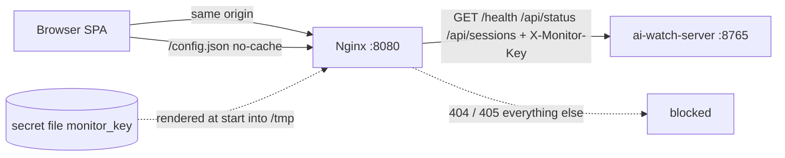

# AI Watch Web

A web dashboard that shows what your AI coding agents are doing: which sessions are working, which need you, how long they have waited, and how much of your usage limits is left. It reproduces the AI Watch firmware screens in a browser and reads the existing [AI Watch server](https://github.com/athegreat90/ai-watch-server). It ships as one small Nginx container for `linux/amd64` and `linux/arm64`.

> **Status: all 13 phases are done, and nothing has been released.** The parity specification (`docs/FUNCTIONAL-PARITY.md`, `docs/API.md`) and the Angular scaffold exist: routing, lazy feature pages, the AMOLED theme and the build and test tooling. The API client, the shared poller, the connection state and the runtime config exist too, and the header shows the connection state. The dashboard, the Sessions pages (list and detail), the Limits page, the NEEDS YOU alert, the task-done celebration, the focus timer, meeting mode, the idle robot and the kiosk work against a real server. Settings works too: theme (AMOLED, dark, light, system), update interval, a connection test, an optional tone and desktop notifications, and demo mode. Every page passes an automated accessibility check (axe) in all three themes. The Nginx image builds and passes its tests for amd64 and arm64, and end-to-end tests drive it in a real browser against the real AI Watch server release. The security scripts, the Trivy policy and the SonarQube configuration exist (see `docs/SECURITY.md`), and the image scan passes with **6 Nginx findings accepted until 2026-12-27** because the fixed Nginx is not published yet. The GitHub Actions workflows (CI, automatic release, manual publish, daily remediation, CodeQL) are written and checked locally, but **no GitHub repository exists yet, so nothing has run on GitHub**. See `docs/RELEASING.md`. Everything below describes the intended behaviour. Items marked **new** are not in the firmware.

## Develop

Needs Node `^22.22.3 || ^24.15.0 || >=26` (`.nvmrc` pins 26.13.1).

```bash
npm ci
npm start              # dev server on http://localhost:4200
npm run lint
npm run typecheck
npm run format:check
npm run test:ci        # unit tests with coverage
npm run build          # production build in dist/ai-watch-web
npm run test:contract  # against a throwaway server, see below
```

**Run against a real server in development.** `npm start` proxies `/api/status`, `/api/sessions` and `/health` to `AIW_DEV_UPSTREAM` (default `http://127.0.0.1:8765`) and adds the key from `AIW_DEV_TOKEN`. The token stays in your environment and never in a file. Write routes are not proxied.

**Contract test.** It checks that what a real AI Watch server sends is what the app's parser accepts. It writes events and limits, so use a throwaway server, and it refuses a non-local URL. Set `AIW_CONTRACT_TOKEN` (and `AIW_CONTRACT_URL` if the server is not on `http://127.0.0.1:8765`). Without a token it does nothing.

## What it does

| Area | Behaviour |
|---|---|
| Dashboard | Connection state, active and attention counts, every session with agent, project, status, duration, waiting time, last update and last successful sync. Manual refresh. |
| Sessions | Full list from `/api/sessions` (up to 40) with a detail view. **New:** the firmware never uses this endpoint. |
| NEEDS YOU alert | Overlay with agent, project and waiting time. Repeats every 120 s. A tap hides it, Acknowledge stops it for that event. |
| Celebration | When a session goes from working to done and the server reports `finished_long` (at least 5 min), shown for 4 s, once per turn. |
| Usage limits | 5-hour and weekly usage per agent, remaining quota, reset time and countdown. Missing data shows "no data". Nothing is invented. |
| Focus timer | 25 minutes, start, pause, resume, reset. Works without the server. Based on timestamps, so a hidden tab does not drift. |
| Meeting mode | Manual, or automatic while the focus timer runs. Suppresses the alert and the celebration, dims the interface. The idle robot is not suppressed, as in the firmware. |
| Idle screen | Animated robot after 15 minutes without activity. |
| Kiosk mode | `/kiosk`: a distraction-free layout for Raspberry Pi and small touchscreens (800x480, 1024x600). |
| Demo mode | **New.** Deterministic example data, clearly labelled, only when the user turns it on. |

Supported agents: Claude Code, OpenAI Codex and Google Antigravity. Other agents that the hooks report (for example Gemini CLI and GitHub Copilot CLI) appear as sessions with a generic icon. Usage limits exist only for the three agents above.

What a browser cannot do: control the screen brightness, guarantee against OLED burn-in, or read the server without a proxy. The web app simulates dimming and lowers burn-in risk, and documents the rest.

## Architecture



- The browser only talks to Nginx. There is no backend of our own and no database.
- Angular standalone components, Signals for state, RxJS only for polling. No NgRx.
- Source layout: `src/app/core` (API, polling, alert, celebration, timer, idle, settings), `src/app/shared`, `src/app/layout`, `src/app/features/{dashboard,sessions,limits,focus,settings,kiosk}`.

### API use

| Endpoint | When | Used for |
|---|---|---|
| `GET /api/status` | Every 3 s after the previous request ends, while the tab is visible | Dashboard, counters, limits, alerts, celebration (up to 8 sessions) |
| `GET /api/sessions` | Same cadence, only on the Sessions page | Full list (up to 40 sessions) |
| `GET /health` | Only on "Test connection" in Settings | Diagnostics |

Polling rules: one shared stream, requests never overlap, timeout 4 s, backoff 3, 6, 12, 24, 30 s with jitter, pause when the tab is hidden, one immediate refresh when it becomes visible. "Stale" means no success for three intervals; the last good data stays on screen, labelled.

Error mapping:

| Response | State |
|---|---|
| 200, valid body | Live |
| 401 with header `X-AIW-Upstream-Status: 401` | "Proxy token rejected" |
| 401 without that header | Dashboard login (Nginx basic auth) |
| 404 | Proxy configuration error |
| 502, 504, timeout | Offline, with backoff |
| 200, unexpected body | "Unexpected response", last good data kept as stale |

Real data is never replaced by demo data.

### Session identity and order

A session is identified by the pair (agent, `session_id`). The server decides the order: needs_attention, error, working, notice, done, idle, then newest first. The web app does not re-sort. Statuses: `working`, `needs_attention`, `done`, `idle`, `notice`, `error`.

## Security model

- **Token:** the server's monitor token is a Docker secret file (`/run/secrets/monitor_key`). At start, the entrypoint checks that it matches `[A-Za-z0-9._~+/=-]{24,}` and renders it into Nginx's config under `/tmp`. If it does not match, the container refuses to start. The token never appears in the JavaScript bundle, `/config.json`, environment variables or logs.
- **Allow-list:** Nginx proxies exactly `GET /health`, `GET /api/status` and `GET /api/sessions`. All other `/api/` paths return 404 and other methods are rejected, so `/api/events`, `/api/event` and `/api/limits` are unreachable. A client-sent `X-Monitor-Key` is overridden.
- **Query strings** are stripped by the proxy, because the server treats them as part of the path.
- **Content Security Policy:** `default-src 'none'; script-src 'self'; style-src 'self' 'unsafe-inline'; img-src 'self' data:; font-src 'self'; connect-src 'self'; manifest-src 'self'; base-uri 'self'; form-action 'self'; frame-ancestors 'none'`. Scripts are never inline. `'unsafe-inline'` applies to styles only, because Angular injects component styles at runtime.
- **Dashboard access:** hiding the token does not protect an open dashboard. By default the container binds to `127.0.0.1`. You can add Nginx basic auth with a secret `htpasswd` file, or put it behind Tailscale or an authenticating reverse proxy. Do not expose it directly to the internet.
- **Container:** non-root, read-only root filesystem, `tmpfs` for `/tmp`, `cap_drop: ALL`, `no-new-privileges`, memory and process limits, local `/healthz` health check.
- **Secure context:** Wake Lock and notifications need HTTPS or `http://localhost`. On a plain-HTTP LAN address they are unavailable, and the app says so.

Threat model summary:

| Threat | Mitigation |
|---|---|
| Anyone on the LAN reads the dashboard | Loopback default, optional basic auth, external SSO documented |
| Token leaks through bundle, config, logs or env | Secret file, never rendered to the client |
| A client calls write endpoints through the proxy | Route allow-list, GET only |
| Many tabs overload the server (16 connections) | Shared poller, visibility pause, optional 1 s microcache |
| XSS | Strict CSP, Angular escaping |
| Supply chain | Digest-pinned images, SHA-pinned actions, `npm ci`, Trivy and `npm audit` |

## Themes

**AMOLED (true black) is the default**, whatever the operating system prefers. Dark, light and system are available in Settings, and the choice is saved in `localStorage`.

| Token | Value |
|---|---|
| background | `#000000` |
| surface | `#0b0c0d` |
| line | `#1d2023` |
| text | `#e4e7ea` |
| muted text | `#8b939b` |
| attention (amber) | `#f5a524` |
| working (blue) | `#5aa9ff` |
| done (green) | `#3ddc97` |
| error (red) | `#ff6b6b` |

Rules: elevation by a hairline border, never shadows or gradients; status colours on small areas only; off-white text instead of pure white; muted text keeps a 4.5:1 contrast on black. `index.html` ships with the AMOLED theme already set, and a small external script applies a saved choice before first paint. Bootstrap runs in `data-bs-theme="dark"` with its CSS variables overridden from the AMOLED tokens.

## Kiosk mode

`/kiosk` opens full screen after a tap. It shows connection state, session count, any session that needs attention and the usage bars, with large type and 48 px touch targets. For low-power devices it uses transforms and opacity only (no blur or shadows). A slow pixel shift and the idle robot reduce burn-in risk, but nothing can guarantee it. The browser flags for a Raspberry Pi will be in `docs/KIOSK.md`.

## Configuration

| Setting | Where | Meaning |
|---|---|---|
| `UPSTREAM_URL` | container env | Where Nginx finds the AI Watch server. No rebuild needed to change it. |
| `monitor_key` | Docker secret | The server's monitor token. |
| `htpasswd` | optional Docker secret | Turns on basic auth for the dashboard. |
| Poll interval, theme, sound, kiosk options | Settings page | Saved in the browser. Never secrets. |

`/config.json` is generated at start from non-secret values and served with `no-cache`.

**Reaching the server:** the server publishes `127.0.0.1:8765` on its host by default, and a container cannot reach that through the host. The deployment bundle will include an optional Compose overlay that runs the server image in the same network. `UPSTREAM_URL` can also point at a LAN address if the server binds to one.

## Run the image

```bash
npm run docker:build        # builds ai-watch-web:local from docker/Dockerfile
mkdir -p secrets && printf '%s' "<the server's monitor token>" > secrets/monitor_key
UPSTREAM_URL=http://host.docker.internal:8765 docker compose up
```

Then open `http://127.0.0.1:8080`. The container serves the app and proxies only `GET /health`, `GET /api/status` and `GET /api/sessions` to the AI Watch server, adding the monitor key itself.

| Setting | Meaning |
|---|---|
| `UPSTREAM_URL` | Where the AI Watch server is, `http://host[:port]`. Default `http://ai-watch-server:8765`. The name is looked up when needed, so the container starts before the server does. |
| `monitor_key` secret | A file with the server's monitor token, at `/run/secrets/monitor_key`. At least 24 characters from `A-Z a-z 0-9 . _ ~ + / = -`, otherwise the container refuses to start. |
| `htpasswd` secret | Optional. A file at `/run/secrets/htpasswd` turns on a login for the whole page. Use `user:{SHA}...` or an `apr1`/bcrypt line. |
| `POLL_INTERVAL_MS` | Optional default update interval, 1000 to 60000. A user's own choice in Settings wins. |
| `RESOLVER` | Optional DNS server. By default the first one in `/etc/resolv.conf`. |

Measured: 27.8 MB compressed for amd64, about 6 MiB of memory at rest, the root filesystem read-only, running as user 101 with all Linux capabilities dropped. Both `linux/amd64` and `linux/arm64` pass the same tests.

Tests of the image need Docker:

```bash
npm run test:entrypoint                                   # the start-up checks, no Docker needed
docker build -f docker/Dockerfile -t ai-watch-web:test .
AIW_TEST_IMAGE=ai-watch-web:test npm run test:proxy       # 104 checks against real containers
```

## Deployment

Deploy without cloning the repository, installing Node or building an image. Each release attaches `ai-watch-web-deploy-vX.Y.Z.zip` (the Compose files, `env.example`, `install.sh`, `install.ps1` and a README), the SBOM of each architecture and `SHA256SUMS`. Everything below is built and tested (`npm run test:deploy`, `npm run test:deploy:windows`); it has not run against a real release yet. The full guide is `deploy/ai-watch-web-deploy/README.md`.

```sh
./install.sh --with-server                 # the page and the AI Watch server next to it, both private
./install.sh --server-url http://192.168.1.50:8765 --token-file ./config.local.json   # a server that runs elsewhere
./install.sh --version v0.1.0 --with-server
./install.sh --update                      # pull again; the container is recreated if the image changed
./install.sh --rollback                    # previous image, recorded in .deploy-history
./install.sh --bind <LAN IP> --auth-user NAME   # open it to other devices, with a login
```

```powershell
.install.ps1 -WithServer          # Windows Docker Desktop, PowerShell 5.1 or 7
```

- **The token is the one thing the installer cannot invent.** It comes from the AI Watch server: `--with-server` creates the server and its token together, `--token-file` takes an existing one. It is written only to `secrets/monitor_key` (a Docker secret). An existing secret or `.env` is never overwritten, and a different token is refused.
- **Why `--with-server`:** a container cannot use the `127.0.0.1` of its host, so a server that listens only there is unreachable from the page. Running both in one Compose project removes the problem. `compose.server.yaml` adds the server and `compose.auth.yaml` adds a login; both are listed in `COMPOSE_FILE` in `.env`.
- **The login** is HTTP basic authentication with a salted SHA-512 hash made by the image itself (BusyBox `cryptpw`), so no extra tool is needed. It is sent in clear text over plain HTTP: for anything but a trusted network use Tailscale or a TLS reverse proxy.
- **A real check at the end:** the installer asks the server through the page with the secret token, and says "refused the token" or "cannot reach the AI Watch server" instead of leaving you with a blank page.
- The settings template is called `env.example` (no leading dot) so it shows in a folder listing.

Images: `ghcr.io/athegreat90/ai-watch-web:latest` and `:vX.Y.Z`, built for `linux/amd64` and `linux/arm64`. Both tags point to the same manifest digest for the newest stable release. Version tags are immutable. Works with Docker CLI, Compose, Portainer, Raspberry Pi, and Docker Desktop on Windows and macOS.

## CI and releases

Modelled on `ai-watch-server`, with Go tooling replaced by Node, Angular and Nginx equivalents.

- **CI** (push to main, pull requests, daily, manual): format, ESLint, TypeScript, unit tests with coverage, production build, Playwright E2E, contract tests against a real server image, `npm audit`, Trivy (files and both images), secret scan, SBOM, container smoke tests, release-tooling tests, release eligibility, SonarQube (non-PR only).
- **Automatic release:** runs only after CI succeeded on a push to main, for the exact tested commit. Patch version bumps automatically for changes to shipped files. Docs-only, test-only and CI-only changes release nothing. One concurrency group serialises automatic and manual publication.
- **Security:** Trivy blocks releases on fixable HIGH or CRITICAL findings, scanned for both architectures. Unfixed findings go into one deduplicated daily issue. A daily workflow proposes base-image updates as a pull request after build, test and scan. It never merges them.
- **Hardening:** actions pinned to full commit SHAs, least-privilege permissions, no secrets for untrusted pull requests.

## Testing

| Level | What |
|---|---|
| Unit (Vitest) | Polling, backoff, ordering, alert and celebration dedupe, focus maths, meeting mode, limits countdown, settings, connection states |
| Integration | API parsing, 401 sources, malformed token refused at start, query stripping, allow-list, header override, token never in any response or log, no CSP violations |
| E2E (Playwright, `npm run e2e`) | 114 tests in Chromium against the built image and the pinned server release v1.1.4 (digest in `compose.test.yaml`): every page, the alert, celebration, focus, meeting, idle robot, kiosk at 800x480 and 1024x600, themes, demo mode, connection states, the proxy rules, security headers, axe in three themes, and the contract test. Fake time for the 2-minute alert, the 25-minute timer and the 15-minute idle. **Not covered yet:** a 400 px phone pass, visual snapshots per theme, and browsers other than Chromium |
| Contract | A pinned server image seeded through `POST /api/events` with relative timestamps |
| Container | amd64 and arm64 start, non-root, read-only filesystem, health check, Trivy |

Coverage target: at least 85 % on `core/`, without tests written only to raise the number.

## Performance targets

Measured on one desktop PC on 2026-11-27 (details, method and what each number does not show: [`docs/PERFORMANCE.md`](docs/PERFORMANCE.md)):

| Target | Result |
|---|---|
| Compressed image at most 30 MB | **Met**: 27.8 MB (amd64), 28.4 MB (arm64) |
| Initial JavaScript at most 150 KB gzip | **Met**: 92.9 KB initial bundle |
| Nginx at most 20 MB RSS | **Met**: 15.9 MiB added up per process (7.7 MiB proportional) |
| Browser heap at most 120 MB | **Met**: 5.5 MiB in 45 minutes |
| At most 20 requests a minute per client | **Missed on the Sessions pages, by choice**: 30 (the status poll plus the list at twice the interval; it was 40); 20 elsewhere, 0 when the tab is hidden |
| Idle CPU under 3 % on a Raspberry Pi 4 kiosk | **Open**: about 0.2 % of one thread on the PC, nothing measured on a Pi |
| A 24-hour soak with a flat heap | **Not demonstrated**: 45 minutes run, no leak found, heap still rising 0.4 to 0.6 MiB an hour and slowing |

## Roadmap

1. Parity specification (done). 2. Scaffold (done). 3. API and state (done). 4. Dashboard and sessions (done). 5. Alerts, celebration, limits (done). 6. Focus, meeting, kiosk (done). 7. Themes and accessibility (done). 8. Nginx and Docker (done). 9. Test suites (done, with the gaps listed in the testing section). 10. Security and Sonar (done, with a time-boxed exception: see `docs/SECURITY.md`). 11. Release automation (done, written and checked locally, not yet run on GitHub). 12. Deploy bundle (done, tested locally, not yet released). 13. Documentation and benchmarks (done).

Details per phase (dependencies, files, acceptance, tests) are in the plan: https://claude.ai/artifact/NM411hN8NGg8T4roqzpwuM

## Reference repositories

The analysis was done on local copies and compared with these GitHub heads on 2026-11-27.

| Repository | `main` head |
|---|---|
| [ai-watch-server](https://github.com/athegreat90/ai-watch-server) | `a495671` (2026-11-26). The contract test runs against release v1.1.4. |
| [ai-watch-firmware](https://github.com/athegreat90/ai-watch-firmware) | `fb7261e` (2026-11-27). Analysed at `97bb7c9`; the two newer commits only update a GitHub Action. |
| [ai-watch-hooks](https://github.com/athegreat90/ai-watch-hooks) | `646f476` (2026-11-26) |

The server and firmware are the source of truth and are not changed by this project.

## Documentation

| Read this | For |
|---|---|
| [`docs/ARCHITECTURE.md`](docs/ARCHITECTURE.md) | How it is built and why: the three parts, the data flow, time, themes. |
| [`docs/API.md`](docs/API.md) | The AI Watch server's contract, as verified from its source. |
| [`docs/FUNCTIONAL-PARITY.md`](docs/FUNCTIONAL-PARITY.md) | Every firmware behaviour and where it lives here, and what is new. |
| [`docs/DEPLOYMENT.md`](docs/DEPLOYMENT.md) and [`deploy/ai-watch-web-deploy/README.md`](deploy/ai-watch-web-deploy/README.md) | Installing it: the installer, Compose, `docker run`, remote access. |
| [`docs/CONFIGURATION.md`](docs/CONFIGURATION.md) | Every setting, secret and storage key. |
| [`docs/KIOSK.md`](docs/KIOSK.md) | Running it on a screen that stays on, and its limits. |
| [`docs/TROUBLESHOOTING.md`](docs/TROUBLESHOOTING.md) | A message or symptom, its cause and the fix. |
| [`docs/TESTING.md`](docs/TESTING.md) | Every test suite, how to run it, and what is not covered. |
| [`docs/SECURITY.md`](docs/SECURITY.md) and [`SECURITY.md`](SECURITY.md) | The checks and what blocks a release, and how to report a vulnerability. |
| [`docs/RELEASING.md`](docs/RELEASING.md) and [`docs/SONARQUBE.md`](docs/SONARQUBE.md) | CI, releases, and the one-time GitHub and SonarQube setup. |
| [`docs/MAINTAINING.md`](docs/MAINTAINING.md) | The routine jobs and the things with a date. |
| [`docs/PERFORMANCE.md`](docs/PERFORMANCE.md) | The measured numbers against the targets, and how to repeat them. |
| [`CONTRIBUTING.md`](CONTRIBUTING.md) | How to contribute. |
| [`CHANGELOG.md`](CHANGELOG.md) | What each release contains (and the next version it declares). |
| [`MEMORY.md`](MEMORY.md) | The decisions, their reasons, and what each phase found. |
| [`CLAUDE.md`](CLAUDE.md) and [`AGENTS.md`](AGENTS.md) | Instructions for coding agents. |
